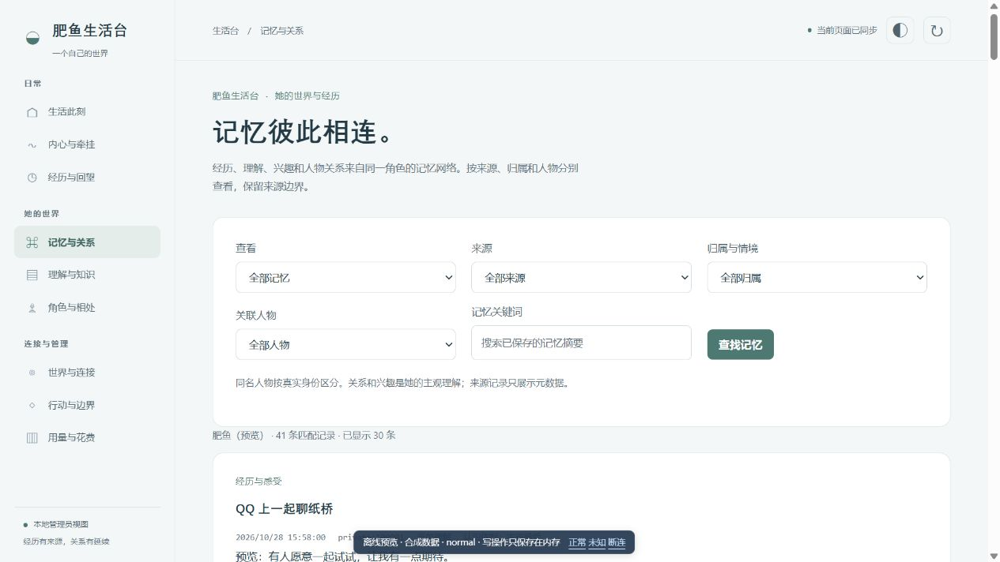
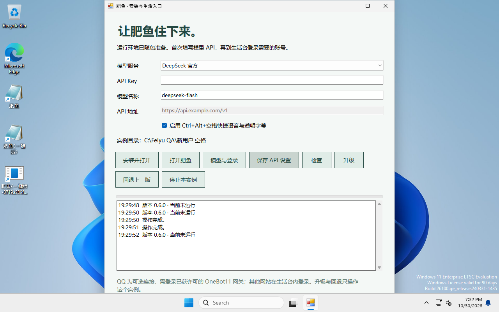

# 肥鱼 Feiyu Life

当前版本：**0.6.0**。新增 Windows 一键部署版，内置 Node、Python、DSH 与本地语音模型，支持升级保留记忆、失败回退和透明字幕。

肥鱼是运行在本机 DSH 上的持续生活智能体。角色核心提供稳定的价值方向，经历、兴趣、关系和当下的想法在本地分别保存，再按当前情境参与理解与表达。

这个仓库把角色运行时、DSH 原生插件、生活台和桌面入口放在同一个部署流程里。QQ 是一种通信连接。网页、视频、文件、微信文字入口和桌面交流，都通过同一角色的记忆与行动边界接入。



> 图片中的人物、对话和记忆都是合成数据。发行包不含开发者的聊天记录、账号、令牌或浏览器资料；Windows 一键版携带公开语音模型和运行时。

## 开始使用

**普通使用者：下载 [Windows 一键部署版 0.6.0](https://github.com/lujingshi1978-glitch/ds-life-and-soul/releases/download/v0.6.0/Feiyu-Windows-0.6.0.zip)**（约 1.04 GiB）。完整解压后双击 `肥鱼.exe`，填 API，点击“安装并打开”，再登录需要的平台账号。无需另装 Node、Python 或 DSH。

已在干净 Windows 11 x64 普通用户环境验收。该部署器管理的实例可升级保留记忆，失败时恢复；不会自动接管旧开发目录。QQ 网关仍是可选外部配置。安装范围、升级和限制见 [Windows 一键版说明](docs/WINDOWS_ONECLICK.md)，校验与结果见 [0.6.0 发布记录](docs/releases/0.6.0.md)。

GitHub 的 **Source code** 下载项是源码，未包含大运行时；直接使用请选择上面的 Windows ZIP。



### 源码模式


当前主要验证平台为 Windows 10/11 x64。先安装 **Node.js 24 LTS（含 npm）**。使用快捷语音还需要 Python 3.11，以及可用的麦克风和音频输出设备。建议解压到较短路径，例如 `D:\Feiyu`。

双击 **`启动肥鱼.cmd`**，或在仓库根目录运行：

```powershell
node scripts/deploy.mjs launch
```

首次运行会询问安装选项，安装依赖，建立独立的 `feiyu` DSH profile，生成新的角色档案和本机凭据，再启动生活台。模型提供方和密钥在本机 DSH 界面配置。平台账号需要由使用者自行登录。

默认端口为 DSH `3081`、生活台 `3110`、桌面网关 `3117`。这些端口与常见的已有 DSH/肥鱼实例分开；遇到不属于本包的端口占用时，启动器会拒绝接管。

**快捷语音：Ctrl + Alt + 空格。** 按下开始录音，再按一次结束；停顿也可自动结束。识别文字与回复以小字幕显示，不弹出大聊天窗。通过托盘设置透明度、大小、位置和鼠标穿透；备用文字窗仍可从托盘打开。详见[网站接入与字幕说明](docs/PLATFORM_CONNECTIONS.md)。

更完整的安装过程见 [安装文档](docs/INSTALLATION.md)，日常操作见 [使用文档](docs/USAGE.md)。

旧版微信扫码若提示找不到 `qrcode` 模块，或二维码生成后不显示，请按 [0.4.3修复与升级说明](docs/WECHAT_QR_FIX.md)更新；保留本机数据，停止服务后双击 `scripts/修复核心依赖.cmd`，再重新启动。

## 能做什么

- **有来源的记忆。** 区分实际观察、他人转述、主观理解与未知信息。兴趣按情境从同一记忆网络召回，经历与分享念头分开保留。
- **逐步形成的关系。** 共同经历会形成可以并存、修正的态度。管理员统一设置相处节奏，具体关系仍由实际交往决定。
- **自主活动与联想。** 外界信息可以唤起相关的人或经历。她可以想分享，也可以不说；系统不靠定时强制消息来制造主动性。
- **网页、视频与资料理解。** 工具保留读取范围和证据，不把采样帧当成看完整个视频，也不把链接标题当成已经读过正文。
- **受限的工作与创造。** 日常聊天、管理员委托工作和 Windows LPAC 创造会话使用不同边界。创造草稿不会自行获得权限或自动晋升到生产。
- **本地生活台。** 查看内心、活动、记忆、关系、知识、角色、连接、权限与用量。
- **统一运行参数。** 各组提供默认值、推荐值和允许范围。推荐预设先预览、再应用到草稿，显式保存才生效；参数调整保留角色核心、来源、人物身份与权限边界。

详见 [功能说明](docs/FEATURES.md)、[架构说明](docs/ARCHITECTURE.md) 和 [边界说明](docs/BOUNDARIES.md)。能力是否可用还取决于依赖、账号和授权。代码存在不等于该平台已经登录。

成长、记忆与来源图的使用方式、验证范围及限制见 [情境成长与召回说明](docs/GROWTH_AND_RECALL.md)。Windows 一键版已完成独立验收；冻结安装包与仓库源码的对应范围见 [一键版说明](docs/WINDOWS_ONECLICK.md)。

## 默认行为

全新安装不导入任何历史记忆。OneBot/QQ 默认关闭，白名单为空，主动联系与网站自主互动关闭。受限创造与独立工作入口也默认关闭。安装快捷语音仅开放本机桌面入口，不授予网站或 QQ 的额外权限。

每日费用软上限默认 **0，表示关闭**。节省、日常与丰富记忆预设分别建议3、10、20元；这是按使用者配置价格估算的调度偏好，不是服务商账单或扣费硬限额。达到上限后暂缓新的自主活动与高开销工作，已有有界工作收尾，正常来信仍可回复，不强杀在飞请求。启用上限后若费用暂不可核实，也会暂缓新的后台活动，页面会明确标明。

本地语音识别使用固定版本的 Whisper 模型。源码模式在首次明确选择语音安装时下载模型；Windows 一键版已携带模型。运行识别时只读本地文件。默认朗读使用 Edge TTS，朗读文本会发送给该服务。对话文本经 DSH 发送给使用者选择的模型提供方。

## 文档与演示

| 内容 | 文件 |
| --- | --- |
| 安装与更新 | [INSTALLATION.md](docs/INSTALLATION.md) |
| 功能说明 | [FEATURES.md](docs/FEATURES.md) |
| 使用手册 | [USAGE.md](docs/USAGE.md) |
| 运行参数、推荐值与费用软上限 | [RUNTIME_SETTINGS.md](docs/RUNTIME_SETTINGS.md) |
| 架构与扩展 | [ARCHITECTURE.md](docs/ARCHITECTURE.md) |
| 安全、数据与权限 | [BOUNDARIES.md](docs/BOUNDARIES.md) |
| 排错 | [TROUBLESHOOTING.md](docs/TROUBLESHOOTING.md) |
| 项目哲学与完整机制介绍（29页） | [feiyu-introduction.pptx](presentation/feiyu-introduction.pptx) |
| PDF 预览 | [feiyu-introduction-preview.pdf](presentation/feiyu-introduction-preview.pdf) |
| 核心、记忆、兴趣与关系的11张演示图 | [demo-images/](presentation/demo-images/) |
| 合成演示数据与素材来源 | [examples/](examples/) |

## 开发与验证

```powershell
node --test tests/*.mjs
npm --prefix packages/feiyu test
node packages/feiyu/scripts/test-life-console.mjs
node scripts/check-public-package.mjs
```

完整验证范围和当前限制见 [验证记录](docs/VALIDATION.md)。运行真实麦克风、平台账号或模型的测试需要明确的本机配置；仓库内的自动化测试使用临时数据库、合成音频和本机协议夹具。

## 许可与致谢

本项目源代码沿用 MIT，并保留 qq-bridge 与 QSH 原作者的版权声明。第三方组件各自适用其许可证，见 [第三方说明](THIRD_PARTY_NOTICES.md) 和 [licenses/](licenses/)。

DeepSeek Harness 通过官方 npm 包安装。QQ登录端需要另行安装并登录，本包不分发或自动启动SnowLuma等网关。首次安装可选择QQ接入向导，已有安装可双击 `scripts/配置QQ.cmd`：填写本机HTTP/正向WS地址、连接令牌、管理员与聊天范围，查询连接和账号状态通过后才保存。详细步骤见 [QQ接入指南](docs/QQ_SETUP.md)。旧的 `@snowluma/sdk` 和 `@snowluma/mcp` 依赖已从本公开包移除。

欢迎提交可复现问题、回归测试和改进。请先阅读 [贡献说明](CONTRIBUTING.md) 与 [安全报告说明](SECURITY.md)。
