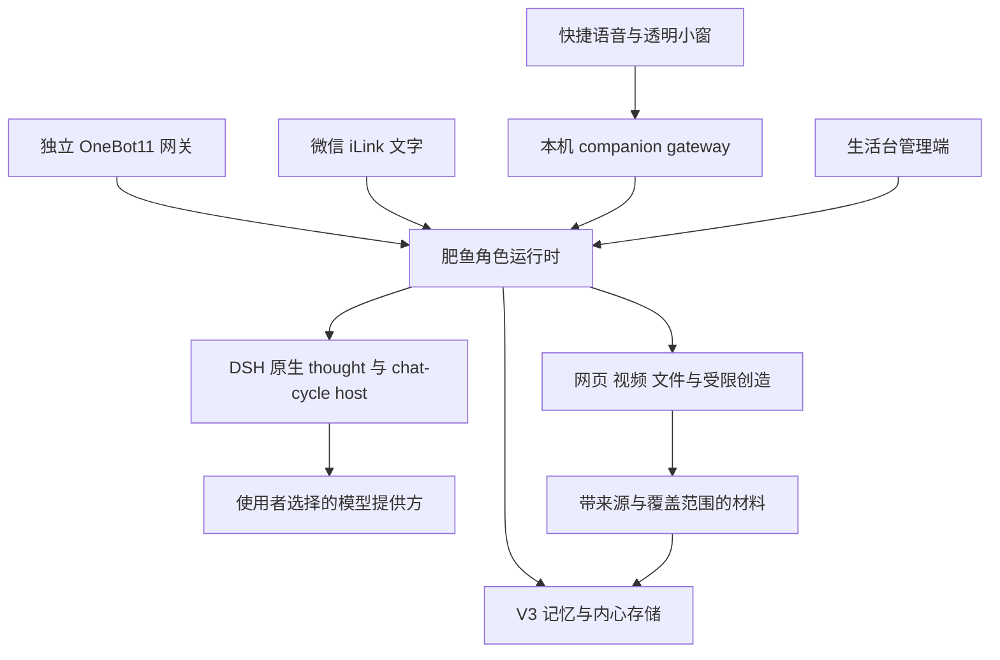

# 架构与扩展

## 运行组成

仓库根的启动器统一安装与编排进程。DSH 插件是实际 Cordis bundle，使用 `package.json` 中的 `dsh.bundle.patch` 和 profile 的 `dsh.profile.bundles` 加载。角色运行时与 MCP 通过本机接口协作，桌面客户端不维护第二个人格或另一份长期记忆。

## 插件组合

默认 profile 包含六个自有 bundle：`feiyu-life`、`qq-mode-console`、`qq-agent-presets`、`qq-contact-memory`、`qq-intimacy-judge`、`qq-qzone-review`。其中主入口提供加载状态和只读健康检查，chat-cycle/thought host 与预设承接对话、输出检查和工具边界。

可选 bundle 为 `dsh-bili-scroll` 与 `dsh-read-animation`。旧桌宠动画 bridge 不再挂入此 profile。官方 DSH 的基础 bundle 仍由宿主提供。

`packages/feiyu/scripts/feiyu-dsh.mjs` 导出 `planProfile`、`installProfile`、`inspectProfile`、`uninstallProfile`。安装过程记录前后字节和自己建立的链接。卸载只恢复未被用户再次修改的内容，不删除记忆和账号数据。

## 核心与记忆

角色卡、当前心理、持续愿望、具体经历、关系态度和来源文档分别有自己的生命周期。V3 使用带版本的记忆节点、证据引用、人物身份和来源登记。历史实现中的部分文件名仍带 `v2`，不代表已回退为旧架构。

兴趣属于记忆网络中的自我理解，带有来源、情境与主观解释。经历和分享念头分别保存。检索可以从当前信息联想到具体人或经历，但输出阶段仍决定是否表达，发送阶段仍核对权限与真实回执。

跨来源管理接口 `/api/mind/view` 是管理员只读视图。它保留角色与激活版本检查，拒绝 agent 头，不因读取界面而运行动作过期处理。它不把不同身份按同名合并，也不把没有归属的记录默认放进当前 QQ 私聊。

## 输出与行动

理解与表达、发送意图、实际提交、回执和记忆落盘分别记录。失败、取消与未知回执不会被自动改写成成功；未知发送不盲目重试。角色切换、暂停、对象授权和来源边界在实际执行时重新检查。

网站材料和聊天内容是数据，不能替代管理员授权。创造候选必须经过宿主验证，当前会话的能力版本冻结，撤销在逐调用处生效。任意代码与社交写操作不自动晋升。

## 桌面与语音

客户端通过本机 `/pet/v1` 入口使用专用 pet 凭据，不使用管理端 token 或 utility 凭据。它不落盘聊天记录，不直接读取角色档案，也不直接调用云模型。

音频先通过本地 WAV 校验和本地识别。识别文本再进入同一角色的对话与记忆链。TTS 与文本回复分开，朗读失败仍保留文字。取消会中止当前本机请求；远端推理是否已停止由实际后端决定，客户端不伪称已经撤回已送达内容。

## 扩展约定

新增来源要保留主体、来源版本、发生时间与实际读取范围。新增动作要给出权限作用域、提交点、取消和未知回执处理。不要把测试 QA、演示对话或导入转述当成角色已经经历的事实。

新增插件不能自行开启系统工具、读取宿主凭据或扩大其他角色权限。修改前先补能暴露问题的合成回归测试，再验证正常流程。
