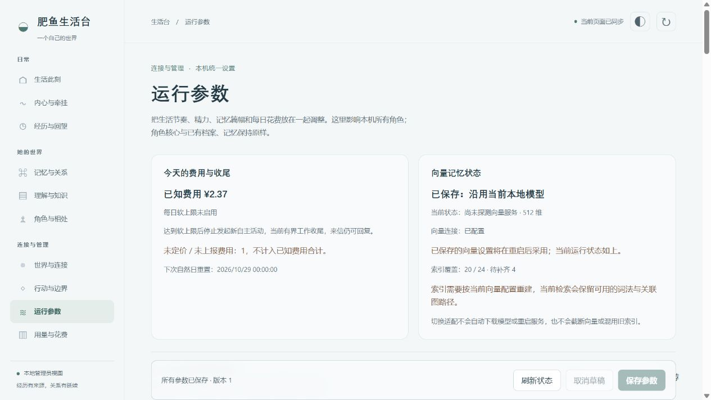

# 运行参数使用手册

适用版本：**0.4.0**。生活台导航中的“运行参数”集中管理生活节奏、精力、记忆检索篇幅、文本长度、睡眠和每日费用软上限。它影响**当前本机的所有角色**，各通信入口继续使用各自所归属的同一角色与记忆。

> 截图来自临时本机夹具，费用、向量状态与数量都是演示数据；它不是使用者的真实活动、模型账单或私人资料。表格中的字段、默认值与推荐值按本版真实参数定义列出。

## 从推荐预设开始

1. 在生活台打开“运行参数”，先看今天的已知费用、向量记忆状态和当前参数。
2. 选择“日常推荐”“节省模式”或“丰富记忆”，点“预览推荐”。此时不会保存，也不会改变运行中的参数。
3. 核对预览中的差异，点“应用到草稿”。还可以继续逐项调整，或点“取消草稿”恢复最近读取的服务器值。
4. 点“保存参数”才提交改动。保存只提交你实际改过的字段，并核对页面载入时的版本。
5. 向量适配标注“重启后生效”；先准备相符的本地模型与连接配置，再重启肥鱼。其余参数从后续适用步骤采用。

| 预设 | 主要取向 | 每日费用软上限 |
| --- | --- | --- |
| 日常推荐 | 维持默认节奏、普通回忆与1000字心理摘要预算 | 10元 |
| 节省模式 | 后台唤醒2分钟；有变化时10分钟、安静时60分钟再考虑自由思考；精简当轮回忆与联想 | 3元 |
| 丰富记忆 | 普通回忆4500字、深入回忆12000字、聊天联想注入7000字；心理摘要2000字 | 20元 |

这些金额是建议配置，不是购买套餐、服务价格或准确账单。预设包含完整的一套参数：除上表所列差异，其余字段采用该预设的默认值。已有个性化修改时，先看完整预览。

**首次安装的每日软上限默认是0，即关闭。** “推荐10元”不会自动替你启用上限；明确保存预设或修改该字段后才会启用。

## 草稿、版本与生效时间

换页、刷新状态时会保留未保存的草稿；同一浏览器标签页重新载入时也会尝试恢复这份草稿。保存成功或“取消草稿”后清除它。浏览器禁用存储、清除标签页数据或关闭标签页后，不承诺继续保留草稿。

若别人或另一个页面已修改参数，旧页面不能直接覆盖新版本。先刷新状态并“核对新版本”，确认服务器最新值，再选择“按新版本继续编辑”。这个动作仍不保存。请求失败不会自动重试写入，现有草稿保留供你检查。

保存后的节奏、精力和文本参数从后续适用步骤采用：已经开始的请求不改写；心理摘要上限在下一次有效整理采用；缩小篇幅不会直接裁掉旧感受或原始记录。向量模型适配属于重启级设置，不会在保存时替换正在运行的向量服务。

## 参数边界

这些设置不会改写角色核心、原始档案或历史记忆，不合并同名人物，不改变资料来源和证据归属，也不扩大网站、通信、工作或创造权限。更频繁地唤醒只增加考虑机会，不要求肥鱼必须行动；更大的预算只增加可选篇幅，不要求模型写满。

“字”在此表示实现采用的文本字符预算，不能直接换算为固定数量的模型 token，也不能据此推算准确费用。时间字段以毫秒存储，表格补充常用换算；夜间窗口和每日费用日界统一使用北京时间。

## 生活节奏与精力

后台唤醒用于处理记忆工人；有变化和安静时的自由思考间隔，决定多久可以再次考虑下一步。前台安静期为最近交谈保留注意力。精力消耗、恢复、醒来阈值和最短睡眠时长一起决定活动与休息节奏。

夜间休眠可跨午夜；开始与结束相同表示取消固定夜间窗口。管理员交互沿用现有豁免。精力倍率调成0不表示开放原本没有的权限。

| 参数 / 配置字段 | 默认 | 推荐 | 允许范围 / 选项 |
| --- | --- | --- | --- |
| 后台唤醒间隔 `life.wakeIntervalMs` | 60000 毫秒 | 60000 毫秒 | 5000–3600000 毫秒 |
| 新机会后的自由思考间隔 `life.idleChangedIntervalMs` | 300000 毫秒 | 300000 毫秒 | 10000–86400000 毫秒 |
| 安静时的自由思考间隔 `life.idleUnchangedIntervalMs` | 1800000 毫秒 | 1800000 毫秒 | 60000–86400000 毫秒 |
| 前台安静期 `life.foregroundIdleMs` | 120000 毫秒 | 120000 毫秒 | 0–3600000 毫秒 |
| 活动时每小时精力消耗 `life.awakeDrainPerHour` | 0.04 满格/小时 | 0.04 满格/小时 | 0–2 满格/小时 |
| 发呆时每小时精力恢复 `life.idleRecoveryPerHour` | 0.06 满格/小时 | 0.06 满格/小时 | 0–2 满格/小时 |
| 休息时每小时精力恢复 `life.restRecoveryPerHour` | 0.08 满格/小时 | 0.08 满格/小时 | 0–2 满格/小时 |
| 睡眠时每小时精力恢复 `life.sleepRecoveryPerHour` | 0.12 满格/小时 | 0.12 满格/小时 | 0.001–2 满格/小时 |
| 精力恢复到多少后醒来 `life.wakeEnergy` | 0.25 满格比例 | 0.25 满格比例 | 0.01–1 满格比例 |
| 单次行动精力消耗倍率 `life.actionCostScale` | 1 倍 | 1 倍 | 0–10 倍 |
| 精力睡眠最短时长 `life.minimumSleepMs` | 0 毫秒 | 0 毫秒 | 0–86400000 毫秒 |
| 夜间休眠开始 `life.nightStartHour` | 0 时 | 0 时 | 0–23 时 |
| 夜间休眠结束 `life.nightEndHour` | 8 时 | 8 时 | 0–23 时 |

时间换算：60,000毫秒=1分钟，300,000毫秒=5分钟，1,800,000毫秒=30分钟。默认夜间窗口为北京时间00:00–08:00。精力的“1”代表一整格。 旧版明确关闭固定夜间休眠的偏好在升级时保留；之后可以直接在本页重新选择开始与结束时间。

## 记忆检索与注入

这一组决定一轮检索可以挑选多少条目、读取多少细节，以及把多少相关资料放进本轮上下文。预算更大不保证资料更相关，也不表示每次都会用满。来源、人物身份、记忆版本与证据边界继续生效。

| 参数 / 配置字段 | 默认 | 推荐 | 允许范围 / 选项 |
| --- | --- | --- | --- |
| 普通回忆文本预算 `memory.recallBudgetChars` | 2200 字 | 2200 字 | 200–30000 字 |
| 深入回忆文本预算 `memory.deepRecallBudgetChars` | 6000 字 | 6000 字 | 500–60000 字 |
| 联想检索预算 `memory.associationBudgetChars` | 2400 字 | 2400 字 | 200–30000 字 |
| 聊天联想注入预算 `memory.dialogueBudgetChars` | 3600 字 | 3600 字 | 300–40000 字 |
| 回忆最多候选条目 `memory.maxRecallItems` | 40 条 | 40 条 | 1–200 条 |
| 聊天联想最多条目 `memory.associationMaxItems` | 5 条 | 5 条 | 1–30 条 |
| 单条记忆详情预算 `memory.detailChars` | 800 字 | 800 字 | 100–10000 字 |
| 单次原文阅读预算 `memory.resourceReadChars` | 16000 字 | 16000 字 | 500–60000 字 |
| 近期经历注入预算 `memory.recentContextChars` | 1800 字 | 1800 字 | 200–12000 字 |
| 人物背景注入预算 `memory.portraitContextChars` | 1800 字 | 1800 字 | 200–12000 字 |
| 向量记忆适配 `memory.embeddingProfile` | 沿用当前本地模型 | 沿用当前本地模型 | 沿用当前本地模型；BGE-small中文 · 512维；BGE-large中文 · 1024维；仅词法与关联图，不使用向量 |

### 向量适配与旧512维索引

- **沿用当前本地模型**（`existing`）：保留现有完整模型标识和维数。
- **BGE-small中文 · 512维**（`bge-small-512`）：选择与本地 `BAAI/bge-small-zh-v1.5` 完整模型身份相符的512维服务。
- **BGE-large中文 · 1024维**（`bge-large-1024`）：选择与本地 `BAAI/bge-large-zh-v1.5` 完整模型身份相符的1024维服务。
- **仅词法与关联图**（`lexical`）：不使用向量召回，继续保留记忆及其关联结构。

512维适配**不把V3记忆降级**。向量按完整模型标识、记忆修订、内容哈希和实际维数隔离；不会把1024维向量截成512维，不补零、不投影，也不会因为“维数一样”就混用别的模型索引。旧512维索引即使缺少后来新增的登记信息，只要完整模型身份、当前记忆版本、内容哈希和向量本身有效，仍可复用；不能确认的部分会显示为待补齐。

页面显示已保存的选择、可取得的向量状态、待重启提示和索引覆盖；保存选择不表示运行中的服务已经切换。未探测向量服务不等于服务已经健康可用；模型不相符或本地连接尚未配置时，会说明原因并保留可用的词法与关联图检索。选择设置不会自动下载模型、替你重启服务或删除另一模型的旧索引。需要重建时，按所选完整模型重新生成对应向量，原始记忆与证据仍保留。

### 注入预算与持久化协议不是一回事

此页的回忆、详情、摘要与原文阅读预算控制**本轮选取、阅读和注入**的篇幅。记忆抽取协议还分别限制持久化字段、结构化数组、单条提案、证据与校验结果；这些属于另一层数据契约。

增大 `memory.detailChars` 或 `text.memoryGistChars`，不会自动扩大持久化抽取字段或放松证据校验。页面只开放实际schema列出的字段，不代表所有协议常量都可以自由修改；超出持久化协议的内容仍按原有校验处理。

## 文本与持续内心

心理摘要、单条线索、背景整理阈值、内部理解选用量和聊天选用量是不同设置。背景整理阈值控制何时考虑整理；它不是每轮都注入的常驻篇幅。聊天默认只参考少量与当前注意力有关的心理背景，增大可能让旧话题更容易持续出现。

内部思考的结构化输入超过本版允许预算时会明确退回，不通过截断JSON或删除证据来凑数。等待时间只影响新发起的认知调用。单条聊天长度控制发送分段，完整回复仍保留。自动注入对话快照预算与工具显式读取原文分开；额外工具读取原文采用独立预算。

| 参数 / 配置字段 | 默认 | 推荐 | 允许范围 / 选项 |
| --- | --- | --- | --- |
| 当前心理摘要预算 `text.psycheChars` | 1000 字 | 1000 字 | 200–12000 字 |
| 单条心理线索预算 `text.psycheThreadChars` | 600 字 | 600 字 | 100–4000 字 |
| 心理背景整理篇幅阈值 `text.psycheBackgroundChars` | 6000 字 | 6000 字 | 1000–48000 字 |
| 心理背景整理条数阈值 `text.psycheBackgroundThreads` | 16 条 | 16 条 | 4–128 条 |
| 内部理解的心理背景预算 `text.psycheContextChars` | 2400 字 | 2400 字 | 200–24000 字 |
| 内部理解的心理背景条数 `text.psycheContextThreads` | 8 条 | 8 条 | 1–64 条 |
| 聊天中的心理背景预算 `text.dialoguePsycheChars` | 600 字 | 600 字 | 100–12000 字 |
| 聊天中的心理背景条数 `text.dialoguePsycheThreads` | 2 条 | 2 条 | 1–32 条 |
| 自动注入对话快照预算 `text.liveChatChars` | 4500 字 | 4500 字 | 1000–30000 字 |
| 单条记忆摘要预算 `text.memoryGistChars` | 600 字 | 600 字 | 100–5000 字 |
| 内部思考材料预算 `text.thoughtInputChars` | 48000 字 | 48000 字 | 2000–80000 字 |
| 内部思考结果预算 `text.thoughtOutputChars` | 24000 字 | 24000 字 | 1000–100000 字 |
| 内部思考等待时间 `text.modelTimeoutMs` | 90000 毫秒 | 90000 毫秒 | 5000–600000 毫秒 |
| 角色卡注入预算 `text.roleInjectChars` | 6000 字 | 6000 字 | 1000–20000 字 |
| 单条聊天消息长度 `text.replyChunkChars` | 500 字 | 500 字 | 50–2000 字 |

## 每日花费与收尾

生活台把用量账本收到的记录，按当前配置的模型价格估算为已知人民币费用。**这是配置价格下的估算，不是服务商账单。** 价格未知、费用未上报或用量不可取得时会标为未知，不把未知部分补成0，也不把它算作准确的已知费用。

| 参数 / 配置字段 | 默认 | 推荐 | 允许范围 / 选项 |
| --- | --- | --- | --- |
| 每天模型花费软上限 `budget.dailySoftLimitCny` | 0 元/天 | 10 元/天 | 0–100000 元/天 |
| 已开始工作的收尾窗口 `budget.windDownGraceMs` | 120000 毫秒 | 120000 毫秒 | 0–1800000 毫秒 |

每日按北京时间00:00划分自然日，页面显示下一次日界重置时间。达到已知估算费用软上限后，进入收尾状态：

- 不再发起新的自主活动或新的高开销工作。
- 普通来信仍可正常回复，不因达到软上限而强制沉默。
- 已经在飞的请求不会被强杀。达到上限前已开始、可有界结束的工作，可在设定收尾窗口内完成。
- 下一自然日重新累计；若要继续调整，仍须由管理员明确保存新设置。
- 启用软上限后，费用未知或账本暂不可核实时暂停新的后台活动，普通回复继续。数据恢复后重新判断；不把未知费用当作零。

它是调度软上限，不是扣费硬阀门。正在返回的调用、正常回复、未知费用和价格估算偏差都可能使实际花费超过所设金额。收尾窗口默认120,000毫秒，即2分钟；窗口结束也不表示会杀死尚未返回的模型请求。

## 参数来源与排错

本页表格对应 `packages/feiyu/src/runtime-tuning.js` 的schema。升级后若页面字段发生变化，以本版API返回的定义、推荐值与允许范围为准；不要把旧版本文档中的字段直接整块覆盖到新配置。

读取失败时先保留草稿，检查肥鱼是否仍在运行及本机管理令牌是否有效。出现版本变化时重新核对；出现向量不匹配时准备相符的本地模型，而不是改维数让旧模型“看起来匹配”。设置页不展示令牌或本机模型路径。

返回[使用手册](USAGE.md)或[功能说明](FEATURES.md)。
